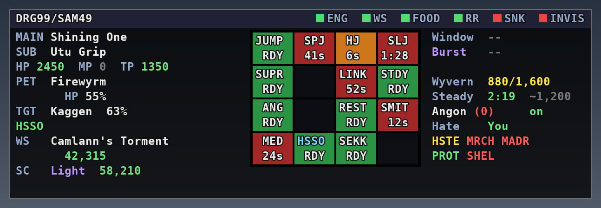
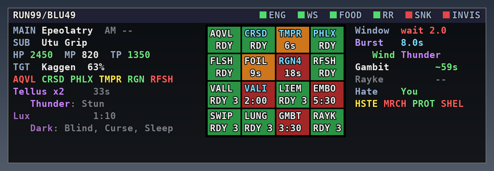
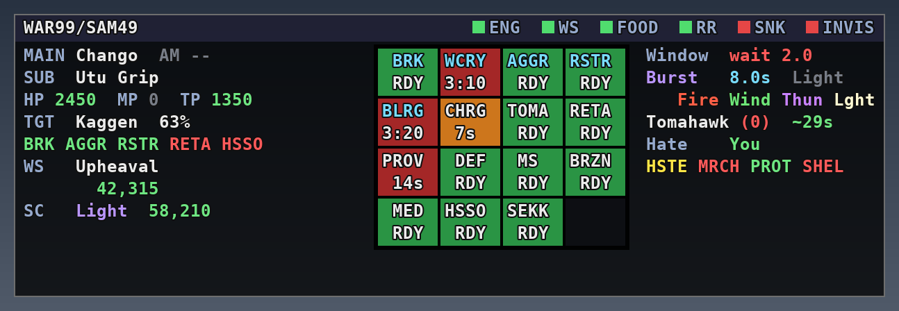
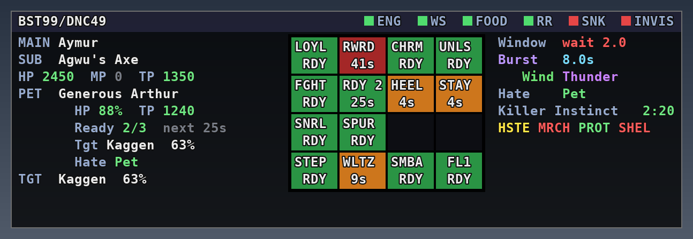
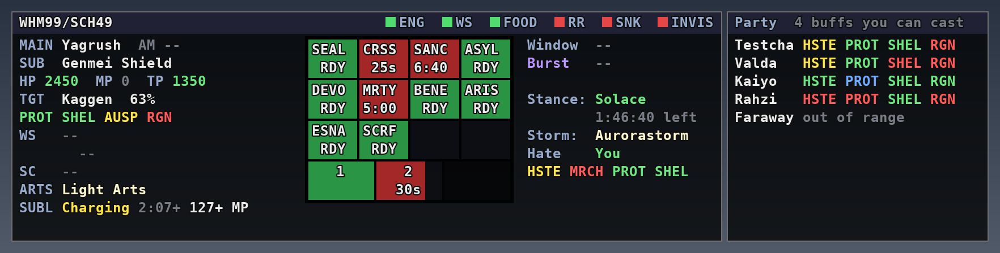
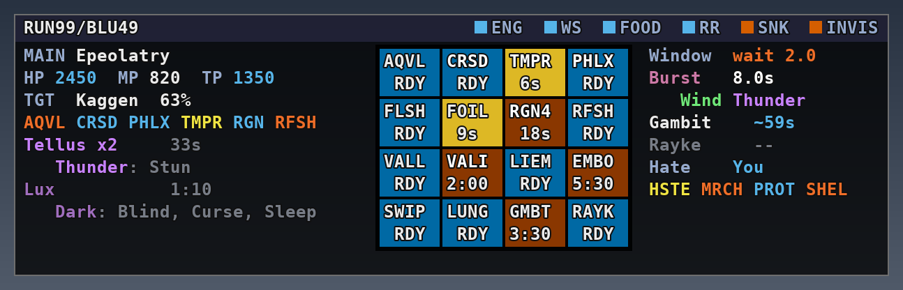

# Job-HUD

A job-aware heads-up display for **Windower 4**, drawn in the *LATTICE* style of
[RahvinGS](https://github.com/RahvinCode/Gearswap): a dark bordered panel with a header strip,
text rows on the left, a recessed grid in the middle, and a second text column on the right.
Here the grid shows **cooldowns** instead of gear.

What's on the panel changes with your main job. **The panel itself stays the same size on every
job**, so it never jumps around or covers something new when you change jobs. Every character
has its own settings file.



## Install

1. Copy the `Job-HUD` folder into `Windower4/addons/`.
2. In game: `//lua load Job-HUD`. To load it every time, add `lua load Job-HUD` to
   `Windower4/scripts/init.txt`.
3. Drag the panel where you want it: hold the left mouse button anywhere on it and move.
   The position is saved for that character. It can't be dragged fully off screen, and
   `//jhud lock` stops it moving (clicks then pass through to the game).

### Updating

Copy the new `Job-HUD` folder over the old one and run `//jhud reload` (or `//lua reload Job-HUD`). You don't need
to reset anything: on load, every setting you never changed moves to the new version's
default, and anything you did change (positions, lists you edited) is kept. Chat says how many
settings were updated. The addon remembers which defaults each character was last updated to in
`data/<CharacterName>_defaults.lua`; leave that file alone.

## Same size on every job

The panel's size comes only from a few layout numbers and your font, never from the job:

| Setting | Default | Command |
| --- | --- | --- |
| Row width (characters) | 32 | `//jhud width <n>` |
| Row lines | 11 | `//jhud lines <n\|auto>` |
| Grid columns × rows | 4 × 4 = 16 cells, always (normal and compact mode) | — |
| Right column width (characters) | 22 | `//jhud rwidth <n>` (0 = no right column) |

- A job with fewer cooldowns than the grid holds shows the rest as **empty slots**.
- A job with more shows as many as fit, and the last cell reads `+N more`. That cell turns
  green or orange if one of the hidden cooldowns is ready or nearly ready.
- Rows that don't fit are cut off, and the last line reads `+N more`. Put the rows you care
  about most first (`//jhud rows ...`), or raise `lines`.
- `//jhud layout` prints the current panel size in pixels.

At the defaults (Consolas 10) the panel is about 627 × 204 px.

## The cooldown grid

One cell per ability or spell, with a short label and the time left:

| Cell | Means |
| --- | --- |
| Green | Ready |
| Orange | Coming off cooldown soon (10 s or less, or the last 20% of the recast, whichever is longer) |
| Red | On cooldown |
| **Purple** | A one-use ability whose effect is waiting on your next action (Stymie, Embolden, Warrior's Charge…); the time still shows its cooldown |
| Slate | Can't use it right now (not learned, level-synced, no avatar out…) |
| Faint | Empty slot |

On RUN, wards and effusions (Vallation, Valiance, Pflug, Battuta, Liement, Swipe, Lunge, Gambit,
Rayke) show how many runes they'd use when ready (`RDY 3`), and turn slate with `0 RN` when you
have no runes up, since they can't be used then.

Purple is for **one-use** abilities on every job: ones whose effect waits on you until your next
action spends it (the next spell, weapon skill, roll, step…). For example Stymie, Spontaneity,
Saboteur, Embolden, Warrior's Charge, Sekkanoki, Sengikori, Sneak / Trick Attack, Divine and
Elemental Seal, Nether Void, Dark Seal, Manawell, Cascade, Futae, the Blue Mage affinities,
Marcato, Pianissimo, Tenuto, Barrage, Crooked Cards, Snake Eye, the flourishes, Presto,
Apogee, Entrust, Blaze of Glory, Theurgic Focus, and the SCH stratagems (each stratagem cell
lights for its own stratagem only). Ongoing effects (Berserk, Crusade, Hasso…) instead show a **cyan label**.
`//jhud activecells off` turns purple off; a job's `highlight` list (`//jhud highlight add
<name>`) makes other cells purple while their effect is on you. In the colour-blind palettes
purple becomes pink (redgreen) or periwinkle (tritan).

Charged abilities show the charges you have next to the label, and the time until the
next charge: `STR 3 / 22s` = three Stratagems up, another in 22 seconds. The addon measures your
real charge time (merits, job points, gear) the first time you use one.

**Job points, merits and gear** are always in the timers: every cooldown in the grid is the game's
own recast timer, which already includes them. Where the addon has to estimate instead (the time
per charge for stratagems, Ready and Quick Draw; how long the buffs you cast on party members and
your songs last), it starts from the base value and **learns the real one** in play: from the first
charge you use, and from the first of your buffs / songs it sees wear off. What it learns is saved
**per character and per job** (`learned_charges` and `learned_durations` in that job's settings),
so each job's job points and gear are kept apart and nothing has to be relearned next time.

Each job comes with a starter list (DRG: all the Jumps, Angon, Call Wyvern, Spirit Link, etc.;
COR: Wild Card, Crooked Cards, Quick Draw, Random Deal…). Your support job adds a few cells
(/SAM adds Meditate, Hasso, Sekkanoki). Support-job abilities you're too low to use
are left out.

## The rows

Every job shows the same top lines: MAIN and SUB weapon, then HP / MP / TP. Each job picks
which other rows it shows. Whatever order a job's list is in, the panel always uses
the same layout:

1. gear, vitals and pet (`weapon` `sub` `ranged` `ammo` `vitals` `tp` `hp` `mp` `pet`)
2. `target`
3. `upkeep`, the buff tags, directly under the target
4. `ws`, the last weapon skill, its damage and the skillchain (every job has it)
5. everything else (`runes`, `buffs`, `rolls`, `timers`, `notes`…) in the order listed

When a job's rows don't fit in the panel's lines, rows that can get shorter do so before
anything is cut off: the weapon skill's damage moves onto the `WS` line (2 lines instead of 3),
then RUN's runes take one line each (`Lux  1:10 Blind/Curse/Sleep`, the name still in its
element's colour).

| Row | Shows |
| --- | --- |
| `weapon` `sub` `ranged` `ammo` | What's equipped in that slot. If your main weapon can give **Aftermath** (its description says so: mythic, empyrean, aeonic, Prime weapons from stage 3…), the MAIN line also shows `AM1`/`AM2`/`AM3`, **what kind** of Aftermath that is for this weapon, and the time left (e.g. `AM3 OA2/3 2:29`), or a dim `AM --` when it's off. The kind is read from the weapon's description: `Acc+` / `Atk+` / `MAcc+` / `MAB+` / `RAcc+` / `RAtk+` (mythic / ergon Lv.1-2), `OA2` / `OA2/3` / `DD` / `DD/TD` (Lv.3: extra attacks or double / triple damage), `ODD` / `OTD` (empyrean), `SC/MB` (aeonic: skillchain and magic burst damage, ultimate skillchains at Lv.3), `PDL` (Prime: physical damage limit). Relic Aftermath shows just `AM`; hover it for the effect. A ranged weapon that gives Aftermath (Fomalhaut, Gastraphetes…) shows it on the RNG line when the main weapon can't |
| `vitals` | HP, MP and TP on one line, on every job (MP shows a dim `0` when you have none) |
| `tp` `hp` `mp` | One of them per line, colored by level |
| `pet` | Pet name, with its HP% and TP indented on the line below (red `none` when no pet is out). Jobs with `pet_info` get more pet lines: **Ready** charges and time to the next one, **Tgt** (what the pet is attacking, with its HP%) and **Hate** (who that mob is attacking: `Pet` green, `You` yellow, anyone else red). On by default for BST |
| `target` | Target name and HP% (add distance with `//jhud distance on`) |
| `ws` | Three lines, always shown: your last weapon skill, its damage indented below it (`Miss` if it missed) followed by the TP you had right after it (`42,315  TP 212`: what the WS gave back; green at 1000+; hover for the TP it used), and `SC` with the skillchain it closed and its damage (`SC --` when it didn't close one). If the weapon skill or skillchain **healed** the mob (it absorbs that element), its line turns **red** and shows `healed` after the amount; heals don't count as damage in `//jhud stats` |
| `upkeep` | Short tags for buffs you keep up: **green** on, **red** off. Wearing off, they **blink slowly**: **yellow** under 30 s left (`upkeep_warn`), **orange** under 10 s. The buff timers (`buffs` row), Aftermath, storm and Klimaform times do the same (`buff_warn`, 30 s) |
| `buffs` | One line per tracked buff that's on you, with time left |
| `timers` | Your own countdowns (see **Timers** below) |
| `runes` | **RUN**: one section per rune you have up (in cast order), named in the color of the element it resists, with count and time left; indented under it, that element and the ailments it helps resist (bright while Pflug is up, dim otherwise) |
| `rolls` | **COR**: each active roll, its number, LUCKY / UNLUCKY / MAX, the lucky and unlucky numbers when you're on neither, and time left |
| `shadows` | `Shadows 3 Utsu`: Utsusemi shadow count, Blink, Third Eye |
| `maneuvers` | **PUP**: active maneuvers by element |
| `fm` | **DNC**: finishing moves, `FM  7  +++++++--`: the count, then one `+` per move up to the most you can hold (`dnc_fm_max`, 9 by default: 5, +2 at the 100 JP gift, +2 at 1200). The game shows exactly 1-5, but only "6+" past that, so above 5 the addon **counts them itself** and marks the number `~`: a Step gives 1, +1 on main DNC, +4 with Presto, +1 with Terpsichore in the main hand; No Foot Rise's "now N" message sets it; flourishes take theirs (the variable ones as many as they can: Reverse / Climactic up to 5, Building up to 3, Animated up to 2). Whenever the buff drops back to 0-5 that's taken as the real count again. Right-column style: `FM: ~7/9` |
| `flourish` | **DNC**: flourishes still waiting to go off, one line each (nothing when none): `CLMX 4/5 rnds 45s` (Climactic: crits on the first swing of the next rounds; one per finishing move used, +1 with a Charis / Maculele Tiara on; a missed first swing doesn't use one), `STRK next swing DA`, `TERN next swing TA`, `BLDG next WS (3 FM)` |
| `dance` | **DNC** (right column): `Dance: Saber 35% 4:45` / `Fan 60% ...` / `None`, with how strong it is now: **Saber Dance**'s Double Attack starts at 50% and falls about 1% a second to 20% (counted from when you used it, or from its time left if the addon missed that); **Fan Dance**'s damage reduction starts at 90% and drops 10% for every melee hit you take, down to 20%. Horos / Etoile Tights (Saber) or Bangles (Fan) raise that 20% floor by 1% per merit (`dnc_dance_merits`, 5 by default). Green at 50%+, yellow 30%+, red below. Under it what it locks you out of: `no Waltz` (Saber) or `no Samba` (Fan). `dnc_dance_reminder` false hides that line |
| `samba` | **DNC** (right column): `Samba: Haste 1:35` (or Drain / Aspir), `None` in red |
| `steps` | **DNC** (right column): Daze from Steps on your target, one line each: `Step: Box     Lv5 2:09`. The level is what the game reports (anyone's Steps count); the time is an **estimate**, so it's dim: 60 s for a new Daze, +30 s per Step after, capped at 120 s, plus your Step Duration job points on your own Steps (`dnc_step_jp`, 20 by default: +1 s per point on each Step and on the cap). Cleared when the Daze wears off or the mob dies |
| `arts` | **SCH** (main or support job): Light Arts / Dark Arts (`+ Addendum`), in the Light / Dark colour; red `none` when you're in neither. Hidden when neither job is SCH (`sublimation` too) |
| `afflatus` | **WHM**: `Stance: Solace` (green), `Misery`, or red `None`, with the stance's time left on the line under it (or, if the game gives it no timer, how long it's been up) (on the left: `AFFL` with the same, no time line) |
| `storm` | **SCH**: the storm on you (Storm II shown as `II`), in its element's colour, with time left; `--` when none |
| `klimaform` | **SCH**: Klimaform time left (green), `--` when off |
| `bounty` | **RNG** (right column): `Bounty Yes` (green) once your target has been hit with Bounty Shot (yours or another player's), `No` (red) until then; cleared when the mob dies or you zone. On RNG it always sits under the Hover and Velocity lines, even if it's not in your `right` list |
| `wyvern` | **DRG** (right column), two lines. `Wyvern  880/1,600`: the wyvern's HP in numbers, coloured by HP% (green, yellow under 75%, orange under 50%, red under 25%). When it's under DRG's pet alarm (`petalarm`, 40%) and **Spirit Link is ready**, the HP **blinks**: time to Spirit Link. The game only gives a pet's HP %, so its max HP is **worked out from the damage it takes** (the damage numbers against how far its HP % drops; the middle of the last few readings); until the first clear hit it shows just the `%`. The learned max is **saved for each character** (`wyvern_hp_learned` in that character's settings file), so next time it's known from the start, and keeps updating from new hits (e.g. after a Wyvern HP gear change). If you know it, set `wyvern_hp` in DRG's settings to use that instead. `Steady  ~2,080 total`: while Steady Wing is on your wyvern, about how much HP it has in all: its HP plus the shield (1.3 x max HP - its HP when you used it). The number's colour follows the time left (3 minutes; blinks in the last 30 s), and hovering shows the time, HP and shield. The game doesn't report what's left of the shield, so it counts as whole until damage gets through (the HP % drops below where it was); then it shows `~720 (used)`, just the HP. The brief HP dip the game shows right after Steady Wing is ignored. Until the max HP is known it shows the time left instead. `Steady  Off` with its recast when it isn't up; the Steady line is always shown, even with no wyvern out |
| `migawari` | **NIN** (right column), two lines: `Migawari: On 49s` (green, with its time left; blinks as it ends) / `Off` (red), and under it `Stance: Yonin` (green), `Innin` or `None` (red) |
| `velocity` | **RNG** (right column): `Velocity: On` (green) / `Off` (red) for Velocity Shot; right under Hover |
| `hover` | **RNG** (right column): Hover Shot stacks out of 25 and whether you've moved since your last shot (`moved` green, `move!` yellow: move at least 1 yalm or the next shot adds nothing). The game doesn't report the stacks, so they're counted from your own ranged attacks and weapon skills while Hover Shot is on you: the first ranged attack (or weapon skill) at a target counts as 1, then +1 per shot fired 1 yalm or more from the last one; shooting a different target starts over at 1 (just switching targets without shooting changes nothing). `off` (with its recast) when Hover Shot isn't up |
| `sublimation` | **SCH**: `Charging` (yellow) or `Complete` (green, use it), how long since you started it, and about how much MP using it will give back; when it's off, the ability's own recast: `Ready` / time left. The MP is an estimate (the game doesn't report it): 2 MP every 3 s at SCH 35, +1 per 10 levels (8 at 95+), plus your worn Sublimation gear (read from the item descriptions, so swaps count), one free tick at the start, up to half your max HP. If the addon was loaded mid-charge, the time and MP get a `+` (only what it has seen) |
| `inventory` | Inventory used / max (amber at 5 free, red when full) |
| `notes` | Anything you send with `//jhud note` (see GearSwap below). Off on every job by default |

The header shows your jobs and levels on the left (with your Master Level, e.g. `DRG99 ML50/SAM59`) and, lined up on the right, indicator squares:

| Square | Colors |
| --- | --- |
| `ENG` | green while engaged |
| `WS` | **green** can weapon skill · **blue** 2000+ TP · **yellow** Amnesia · **red** can't (under 1000 TP, or asleep, stunned, petrified, terrorized, charmed or impaired) |
| `FOOD` `RR` | green when on, **orange** in the last 5 minutes, **red** when missing |
| `SNK` `INVIS` | green when Sneak / Invisible is on, **red** when it isn't |

Also available: `pet`, `signet`, `sync`. Choose them with `//jhud header`.





## Your jobs

These have tuned setups. Everything is editable; see **Character settings** and **Commands**.

| Job | Rows | Grid (4 per row) | Upkeep tags |
| --- | --- | --- | --- |
| **DRG** | weapon, HP + TP, wyvern (HP/TP), target + HP%, upkeep tag, last WS + damage | Jump, Spirit Jump, High Jump, Soul Jump · Super Jump, —, Spirit Link, Steady Wing · Angon, —, Restoring Breath, Smiting Breath · (empty) · /SAM: Meditate, Hasso, Sekkanoki | Hasso (/SAM) |
| **RUN** | weapon, vitals, target + HP%, buff tags, a section per rune (resisted element + ailments) | Aquaveil, Crusade, Temper, Phalanx · Flash, Foil, Regen IV, Refresh · Vallation, Valiance, Liement, Embolden · Swipe, Lunge, Gambit, Rayke | Aquaveil, Crusade, Phalanx, Temper, Regen, Refresh |
| **WAR** | weapon, vitals, target, upkeep tags, last WS + damage (+ skillchain), buff timers | Berserk, Warcry, Aggressor, Restraint · Blood Rage, Warrior's Charge, Tomahawk, Retaliation · Provoke, Defender, Mighty Strikes, Brazen Rush · /SAM on the bottom row | Berserk, Aggressor, Restraint, Retaliation, Hasso (/SAM) |
| **BST** | weapon, off-hand, vitals, pet (HP/TP, Ready charges, its target, who has hate), target | Bestial Loyalty, Reward, Charm, Unleash · Fight, Ready, Heel, Stay · Snarl, Spur · /DNC on the bottom row (Heel and Stay share one timer in the game) | — |
| **WHM** | weapon, off-hand, vitals, target, upkeep tags (Protect, Shell, Auspice, Regen), WS/SC; with /SCH also Arts and Sublimation (time charging, estimated MP back). On the right: Afflatus stance, and with /SCH `Storm: Aurorastorm` (or `None`) | Divine Seal, Divine Caress, Sacrosanctity, Asylum · Devotion, Martyr, Benediction, Arise · Esuna, Sacrifice, two empty slots · support job (/SCH: the 5-bubble stratagem bar) | Protect, Shell, Auspice, Regen |
| **RDM** | weapon, off-hand, vitals, target, buff tags, last WS + damage; the **party window** is on (party members and the buffs you can cast on them) | Composure, Haste, Refresh, Phalanx · Temper, Stymie, Spontaneity, Convert · Saboteur, Chainspell, Dispel, Distract · support job on the bottom row. Stymie, Spontaneity and Saboteur turn **purple** while their effect waits on you | Composure, Haste, Refresh, Phalanx, Temper |
| **BRD** | weapon, off-hand, instrument, vitals, target, WS/SC, buff timers; on the right, `Song:` your songs on your target (newest first, up to 2: `Song: Carnage Elegy` / `Requiem VII`), `--` when none; a resisted song isn't listed, and one goes away when it wears off or the mob dies (`foesong` row) | Each cell 2 wide: Nightingale, Troubadour · Pianissimo, Marcato · Clarion Call, Soul Voice · support job on the bottom row. Nightingale / Troubadour are merits (empty until merited); Pianissimo and Marcato turn **purple** while they wait on your next song | — |
| **SCH** | weapon, off-hand, vitals, target, Arts, storm, Klimaform, Sublimation | Switches with your Arts. Light: Accession, Rapture, Altruism, _ · Penury, Celerity, Tranquility, Perpetuance. Dark: Manifestation, Ebullience, Focalization, _ · Parsimony, Alacrity, Equanimity, Immanence. Row 3 is a stratagem bar: one box per charge you can hold (5 at 90+), squeezed into the row's width. Held charges are full, the one charging fills up as it charges (with its time), the rest are empty. Row 4: Sublimation, Modus Veritas, Enlightenment, Tabula Rasa (no support-job cells on SCH). With no Arts up the stratagem cells go grey | — |
| **RNG** | weapon, off-hand, ranged (with Aftermath), ammo, vitals, target, WS/SC, buff timers; on the right: Hover Shot stacks, `Velocity: On / Off` (Velocity Shot), Bounty Yes / No; the party tags show `FLRY` (Flurry) while Velocity Shot is up and `HSTE` (Haste) when it isn't (`#HASTE` in the `party` list) | Ammo (3 wide: equipped ammo, how many in the slot and `+N` more in your inventory / wardrobes; flashes red under 10, `ammo_warn`) and Barrage · Shadowbind, Scavenge, Camouflage, Sharpshot · Bounty Shot (2 wide), Double Shot (2 wide) · Flashy Shot, Stealth Shot (each only once merited, an empty slot until then), Overkill, Unlimited Shot | — |
| **GEO** | weapon, off-hand, vitals, luopan, target, WS/SC, buff timers | One big 4x4 box: *why are you here, go use GEO-HUD* (`#GEOHUD`; swap in your own list with `//jhud cd` if you ever want cooldowns here) | — |
| **NIN** | weapon, off-hand, ammo, vitals, target, WS/SC, shadows, buff timer (Issekigan); on the right `Migawari: On 49s` / `Off` and `Stance: Yonin` / `Innin` / `None` | Utsusemi: San, Ni, Ichi, Shihei (how many you have in **all** your bags: inventory, Mog Safe / Safe 2, Storage, Locker, Satchel, Sack, Case and Wardrobes; hover for where they are. Flashes red under 10, `NONE` at 0; the number of Shihei toolbags follows in brackets, `87(2)`; 10+ toolbags show as `(*)`, and when it all won't fit the 5-character cell the Shihei count shows alone with a `*`, `106*`. Hover for the exact numbers) · Yonin, Issekigan, Sange, Futae · Innin, —, Mikage, — · support job (/WAR: Provoke, Berserk, Warcry, Aggressor) | — |
| **DNC** | weapon, off-hand, vitals, target, WS/SC, finishing moves, flourishes, Presto; on the right Dance (with `no Waltz` / `no Samba`), Samba, Steps on your target | Presto, Steps, Flourishes II, Flourishes III · Saber Dance, Sambas, No Foot Rise, Flourishes I · Fan Dance, Contradance, Waltzes, Jigs · Grand Pas, Trance, support job. **Waltzes** each have their own timer, so the cell shows the highest one that's ready (`CW5`, `CW4`...) or, when none are, the one back soonest. **Jigs** share one: `SJIG` (Spectral), or `CJIG` while Chocobo Jig's speed is on you | — |
| **COR** | weapon, off-hand, ranged, ammo, vitals, target, buff timers | Wild Card, Crooked Cards, Cutting Cards, Random Deal · Double-Up, Snake Eye, Fold, Quick Draw · rows 3-4 are two big **roll boxes**, one per Phantom Roll on you (oldest first). Each shows the roll and its number, what it raises, the bonus at that number (`LCKY` / `UNLK` / `MAX` when it fits), the lucky / unlucky numbers and time left. Box colour: green lucky or 11, red unlucky or bust, orange any other number, grey if the number wasn't seen (rolled before the addon loaded). Hover a box for the full effect name, the Phantom Roll+ gain per point, and the extra from the roll's job (or gear) in the party. No support-job cells on COR. When you **bust**, the bottom of the right-hand column says *That's showbiz, baby!* until the bust wears off or you Fold (`showbiz` right row), with the animation (`images/showbiz/`) playing above it when there's room; `showbiz_gif` false in the settings file turns the animation off | — |

**Master Levels** raise your support job by 1 per 5 Master Levels (up to 59 at ML 50, never above
that job's own level). The addon reads your Master Level and uses the raised level for which
support-job spells and stratagems you can use; support-job abilities come from the game's own list,
which already includes them.

Support-job cells sit on the **bottom row** of the grid (`//jhud grid sub after` puts them
right after the job's own cells instead). Your job's own cells always come first: support-job
cells only fill slots that are left over, so a job that fills all 16 (like RUN) shows none. /SAM adds Meditate, Hasso, Sekkanoki;
/DRK adds Last Resort, Souleater, Arcane Circle, Stun; /WAR adds Provoke, Berserk, Warcry, Aggressor; /NIN adds Utsusemi: Ni | Utsusemi: Ichi | (blank) | Shihei
counter (all bags; no Yonin/Innin, a support job can't use the stances), and puts a `Shadows:` count on the right (just above the party tags) unless the job
already shows shadows; /DRG, /DNC etc. have their own. /BLU adds nothing. /SCH turns the bottom row into the stratagem bar: **3** bubbles (a support job
holds at most 3 stratagems; main job SCH gets 5), one per charge, filling up as charges come back
(held ones green, the one charging fills with its time). Charges go by level: 1 at 10, +1 every
20 levels, so /SCH49 holds 2 (the third bubble stays dark) and /SCH50+ with Master Levels holds 3.
Each charge comes back in 240 s divided by that number (120 s at 2, 80 s at 3, 48 s at 5 on SCH);
the addon also learns the real time from your timers.

Pet commands (Ready, Spur, Run Wild, Snarl, Steady Wing, the breaths) show slate when no pet is
out. Upkeep tags for things you can't use right now (not learned, wrong subjob) are left out,
so Hasso only appears on /SAM.

## Party window (optional)

A second window, just to the right of the main one, that lists you and your party members with
the buffs **you** can cast on them. Each job remembers whether it's on: it starts **on for RDM**
and off for the rest; `//jhud pw on` / `//jhud pw off` sets it for the job you're on. The buffs:

| Colour | Means |
| --- | --- |
| **Green** | They have it |
| **Yellow** | Under a minute left on it |
| **Light blue** | They have it, but a weaker tier than you can cast (Protect IV when you can cast Protect V, Haste when you have Haste II) |
| **Red** | They don't have it |
 `//jhud partywindow on`
(or `//jhud pw on`) turns it on for your current job, `//jhud pw off` hides it, `//jhud pw <width>`
sets its width in characters (default 29). Like the main panel, it's **the same size on every
job**: that width, and **the same height as the main panel**. Each member gets up to 2 lines; tags
that would need more end in a dim `+`, and if a full party runs past the bottom, the last line
says `+N more lines`.

**Moving it:** it starts docked beside the main window and follows it around. Drag the party window
itself to put it anywhere on its own (it then stays put when you move the main window; the spot is
saved, and `//jhud lock` stops it moving too). `//jhud pw reset` (or `//jhud reset pw`) docks it
back beside the main window.

- Which buffs: every spell or ability you can use right now that can target a party member and
  gives a buff (Haste, Flurry, Refresh, Phalanx, Protect, Shell, Regen, Adloquium, Embrava...),
  so it changes with your job, support job and level. Self-only ones (Auspice, Aquaveil, Stoneskin,
  songs) aren't listed. Sneak, Invisible and Deodorize are left out (`party_window_skip` in the
  settings file).
- Members' buffs come from the game's party buff updates; a member out of range or in another zone
  says so instead.
- The game doesn't send how long other members' buffs have left, so the addon times the ones
  **you** cast on them: the spell's base duration at first, then the real time once it has seen
  one of yours wear off (so your Enhancing duration gear counts). Buffs from other people stay
  green until they wear. Your own line uses your real timers.
- The tier (light blue) is known when the addon sees the spell being cast on them, by you or anyone
  in range; a buff it didn't see cast is just green.
- **Your songs (BRD).** Songs aren't listed up front (there are far too many); instead, once you
  sing a song, it appears on each member it landed on, after their other tags, in the order you
  sang them: `MIN5 MIN4 VMAR` (Valor Minuet V, IV, Victory March). Green (**pink** if you sang it
  under Soul Voice), yellow with under a minute left, and gone when it wears (the addon learns your real song length from the first one
  that wears). Tags: family + tier (`MIN5`, `BAL3`, `PAE6`, `MNE5` Minne), or first letter +
  family where the name tells them apart (`HMAR` Honor March, `BMAD` Blade Madrigal, `FCAR2` Fire
  Carol II). Only your own songs are shown (another bard's can't be told apart). Song slots you
  haven't filled on someone show as grey `SNG1 ... SNG5` (so a member with two of your songs
  reads `MIN5 MIN4 SNG3 SNG4`, then `SNG5` on their second line); the number of slots is
  `song_slots` in BRD's settings (default 5: with Clarion Call and Daurdabla).
  The party window is on for BRD by default.
- **Which buffs on whom.** Each buff can be limited to certain jobs or players; a buff that isn't
  for a member leaves a blank in their row (so the columns stay lined up). Out of the box, Flurry
  shows only on RNG and COR, and Refresh only on jobs that use MP (WHM BLM RDM PLD DRK BLU SMN SCH
  GEO RUN BRD); everything else shows on everyone. Members' jobs come from the game's party
  updates; until it knows someone's job, they get every buff.
  - `//jhud pw for` lists the rules.
  - `//jhud pw for Haste WAR SAM DRG Valda` shows Haste only on those jobs and that player.
  - `//jhud pw for Haste all` shows it on everyone again.
  - Or edit `party_window_for` in the settings file: `Flurry=RNG COR,Refresh=WHM BLM ...`.
- **Hide a buff on a player or party slot.** `//jhud pw hide Storms Valda` hides all eight storms on
  Valda; `//jhud pw hide Storms p2` hides them on whoever is in party slot 2 (p0 = you, p1-p5 =
  the others in party-list order); `all` hides them on everyone. Works with any buff name too
  (`//jhud pw hide Phalanx p3`). `//jhud pw unhide Storms Valda` undoes one, `//jhud pw unhide
  Storms` all of them, and `//jhud pw hide` lists what's hidden. Saved as `party_window_hide`
  (`Storms=Valda p2`). `Storms` also works with `pw for` (`//jhud pw for Storms SCH BLM`).
- Rows are kept short: at most **4 tags per line**, the rest on a second line indented a little
  (up to 2 lines per member); gaps from buffs a member doesn't get close up when that saves a
  line; the name column is 7 letters; and the
  **Haste and Flurry share one spot** (they don't go on together): it shows whichever the member
  has; with neither, `FLRY` in red where Flurry is tracked for them (RNG / COR) and `HSTE`
  elsewhere. The
  eight storms share **one tag**, since only one storm can be on someone: it names the storm they
  have (`AURO`, `FIRE`...) or reads `STRM` in red when they have none. Spontaneity is left out.
- With a full party (6) it lists only the other five (your own buffs are on the main window), so
  everyone fits at 2 lines each.
- It follows the main window when you drag it.



## Compact mode

`//jhud compact` (or `compact on` / `compact off`) shrinks the main window to the grid plus one
narrow column. The weapon lines, WS / SC, Window, Burst and the party tags go; the column keeps,
top to bottom:

- **HP / MP / TP** and your **target**
- stances and similar, moved over from the right: `Stance:` (WHM), `Migawari:` + `Stance:` (NIN),
  `Storm:`, `Hover` / `Velocity` / `Bounty` (RNG), `Wyvern` / `Steady` (DRG), `Song:` (BRD)
- shadows (also on /NIN), runes, Arts / Sublimation, maneuvers, Fencer, rolls
- **your own buffs**: the job's buff tags and buff timer lines
- **Hate**, if there's room for it (it's the first thing left off when the column is full)

Each job can pick its own: `//jhud compact rows` lists them, `compact rows add|remove|move <row>`
changes them, `compact rows clear` goes back to the automatic list. The setting is per character;
the party window isn't affected. The header drops PET, SIG and SYNC and always shows SNK and INVIS (even if they're not in your `header` list); if the narrower strip still can't fit everything, the other squares are left off first.


## The right-hand column

A second text area to the right of the grid, the same height as the left side. Each job picks its
rows (`//jhud right ...`); any left-side row works there too, plus:

| Row | Shows |
| --- | --- |
| `window` | The skillchain window on your target. `wait 2.1` (red) until it opens, then a countdown to when it closes (green, **yellow** for the last 2 s), `--` when there's none, `closed` when the chain can't go further |
| `burst` | Right under `window`: the **magic burst** window after a skillchain lands, counting down to when it closes, with the burst elements in their colours on the line below (and the skillchain's name when it fits). Its label is purple and its time cyan, so it's easy to tell apart from `window` |
| `debuffs` | Your debuffs on the target from the job's list, with time left; `--` when it isn't on. Angon and Tomahawk also show how many you have, e.g. `Angon (12)` (inventory + wardrobes; red at 3 or fewer) |
| `aggro` | **Hate**: who your target is attacking: **You** (green), **Pet** (yellow), or their name (red). On every job |
| `party` | Tags for buffs other people keep on you, green on, yellow under 10 s, red off (no blinking). Default: `HSTE`/`FLRY` Haste or Flurry (one tag, since they don't go on together: `FLRY` while Flurry is on you, else `HSTE`; `#HSFL` in the list), `MRCH` March, `MADR` Madrigal, `PROT` Protect, `SHEL` Shell. (RDM leaves out Haste, which you cast yourself; RNG swaps Haste / Flurry with Velocity Shot.) Add any buff by name, or `ROLL` for any Phantom Roll: `//jhud party add RFSH=Refresh` |

**Skillchain window.** Any weapon skill that lands on the mob, yours or a party member's, opens
a window: it opens 3 s after the weapon skill and closes 10 s after it. Each skillchain opens a
new window 1 s shorter than the last. After step 5, or after Radiance or Umbra, the chain is
closed. This follows the timing used by the
[Skillchains](https://github.com/Ivaar/Skillchains) addon; it only shows the countdown, since
that addon lists what can continue the chain.

**Debuff timers.** DRG: Angon. WAR: Tomahawk. RUN: Gambit, Rayke. A timer starts when your
ability lands (not on a miss) and ends when the game says it wore off, or the mob dies, or you
zone. Merits, job points and gear change these durations, so until the addon has seen one wear
off on its own the time is an estimate from the base duration (Angon 30 s, Tomahawk 30 s,
Gambit 60 s, Rayke 30 s) and shows a `~`. The first time one wears off naturally, the real
duration is saved (`debuff_times` in your settings file) and used from then on. If an estimate
runs out before the debuff wears off, it shows `on`.

| Job | Right column |
| --- | --- |
| DRG | window, burst, Angon, hate, party buffs |
| WAR | window, burst, Tomahawk, hate, party buffs |
| RUN | window, burst, Gambit, Rayke, hate, party buffs |
| BST | window, burst, hate, buff timers (Killer Instinct, Unleash, Spur), party buffs |
| every other job | window, burst, hate, party buffs |

**Pet HP alarm.** On DRG and BST, when your wyvern or pet drops under 40% HP, its lines flash
red and any **ready** Spirit Link, Steady Wing or Reward cell flashes blue, so you see the save
in time. `//jhud petalarm 50` / `//jhud petalarm off` sets it for the job you're on.

**Low-HP alarm.** Each job can set a `danger` HP%: while your HP is under it, the panel's frame
and header strip flash red. It's on for RUN at 50% and off for the other jobs;
`//jhud danger 40` / `//jhud danger off` sets it for the job you're on.

## Hover details

Hover the mouse over the panel to see what anything means: a grid cell (full ability name,
time left and full recast, charges), a header square, a buff tag (full buff name and time
left), a debuff line, the Aftermath tag, the skillchain and burst lines. `//jhud tooltips off`
turns this off.

## Session stats

`//jhud stats` prints this session in chat: each weapon skill's count, average and best damage
(and misses), skillchains made, and kills (yours, your pet's and your party's), with weapon
skills, skillchains and kills per hour once the session is 5 minutes old.
`//jhud stats reset` starts a new session.

## Fade when idle

When you're not engaged for 10 seconds, the cooldown grid (cells and their text) fades to 40%;
the rest of the panel stays as it is. It comes back the moment you engage, put the mouse over
the panel, or the low-HP alarm goes off. `//jhud idle 25 15` = fade to 25% after 15 s;
`//jhud idle 0` hides the grid instead; `//jhud idle off` never fades.

## Look: themes, colour-blind palettes, opacity

| Setting | Choices | Command |
| --- | --- | --- |
| Theme | `lattice` (default), `light`, `contrast` | `//jhud theme light` |
| Palette | `normal`, `redgreen` (protanopia), `deut` (deuteranopia), `trit` (tritanopia) | `//jhud look deut` |
| Opacity | 0–100 (panel and cell backgrounds; text stays solid) | `//jhud opacity 70` |

The palettes change every colour that carries meaning (ready / soon / cooldown cells, on /
ending / off tags, good / warning / bad text, header squares) to colours from the Okabe-Ito set,
which stay distinct with those kinds of colour blindness:

| | normal | redgreen | deut | trit |
| --- | --- | --- | --- | --- |
| Ready / on | green | blue | blue | teal |
| Soon / ending | orange / yellow | yellow | yellow | pink |
| Cooldown / off | red | dark orange | dark purple / magenta | red |

The light theme also darkens coloured text so it reads on a light panel. None of this changes
your `<colors>` in the settings file, so switching back is exact. You can also type the names:
`//jhud look deuteranopia`, `protanopia`, `tritanopia` (or `//jhud palette ...`).




## Timers

Countdowns of your own, shown in the `timers` row:

```
//jhud timer Pop 5:00        five minutes
//jhud timer NM window 1:30:00
//jhud timer Pull 45         45 seconds (also 10m, 2h)
//jhud timer clear Pop       remove one (timer clear = all)
//jhud timers                list them
```

A timer turns amber near the end, shows `DONE` for a few seconds, and puts a line in chat.
Timers last for the session.

## Character settings

Each character gets `addons/Job-HUD/data/<CharacterName>.xml`, written the first time they
log in. Every option is in it. Each job has a block:

```xml
<DRG>
    <rows>weapon,vitals,pet,target,upkeep,ws</rows>
    <cooldowns>JUMP=Jump,SPJ=Spirit Jump,HJ=High Jump,SLJ=Soul Jump,SUPR=Super Jump,LINK=Spirit Link</cooldowns>
    <buffs></buffs>
    <upkeep>HSSO=Hasso</upkeep>
    <right>window,burst,debuffs,aggro,party</right>
    <debuffs>Angon</debuffs>
    <party>HSTE=Haste,MRCH=March,PROT=Protect,SHEL=Shell</party>
    <danger>0</danger>
</DRG>
```

For `upkeep`, name the spell or ability you'd recast (`Crusade`, `Temper`, `Regen IV`); the
addon knows which buff each one gives.

Lists are comma separated, with names exactly as they appear in game. A cooldown can carry its
own cell label with `LABEL=Name`; without one the addon makes one up. Abilities that share a
timer (all Phantom Rolls, all Runes, all Quick Draws, all Blood Pact: Rages) only need one of
them listed. `A|B` means "the first of these you can use": `HSTE=Haste II|Haste` shows Haste II's recast
if you know it, else Haste's (handy for Job Point spells like Refresh III and Temper II). This
works for upkeep tags too. A `_` in the list leaves that grid slot empty, so you can line cells up by row
(DRG's second row is `SUPR=Super Jump,_,LINK=Spirit Link,STDY=Steady Wing`). `A/B` is a Light Arts /
Dark Arts pair: `ACCN=Accession/MANI=Manifestation` shows Accession in Light Arts and Manifestation in
Dark Arts, and greys the cell out when neither Arts is up. `#STRAT` takes a whole grid row for the stratagem
charge bar, and `#ROLLS` turns the next two rows into the big Phantom Roll boxes. `#AMMO` is the ammo cell. Add
`#COUNT:<item>` is a counter of that item across all your bags (`SHIH=#COUNT:Shihei`). Add
`*N` to make a cell N cells wide: `BOUNTY=Bounty Shot*2`, `#AMMO*3`. Start a cell with `?` to show it
only once you have the ability: `?FLSH=Flashy Shot`.

**Merit abilities** (Group 2: Warrior's Charge, Tomahawk, Angon, Deep Breathing, Snake Eye, Fold,
Flashy / Stealth Shot, Killer Instinct, Feral Howl, Altruism, Focalization, Tranquility,
Equanimity, Enlightenment, Nightingale, Troubadour, Fealty, Chivalry, Nether Void, Diabolic Eye,
Feint, Assassin's Charge, Martyr, Devotion, Formless Strikes, Mantra, Shikikoyo, Blade Bash,
Convergence, Diffusion, Role Reversal, Ventriloquy, Saber Dance, Fan Dance, No Foot Rise) work like
that on their own: in your job's grid, a merit ability you haven't merited leaves its slot empty
instead of showing a grey square, and the other cells keep their places. The `<subjobs>`
block holds the extra cells for each support job.

The `<layout>` block (width, lines, columns, grid_rows) is shared by all of that character's
jobs. That's what keeps the size fixed. Other options in the file: position, font and size,
colors for every part of the panel (including `empty` slots), cell width and grid position
(`right` or `bottom`), `soon_seconds` and `soon_pct`, `buff_warn` (seconds at which a timer
turns amber), `hide_unavailable`, `hide_missing_buffs`, `hide_in_cutscene`, `announce_ready`,
`update_rate`, and `charges` (`Name:max:seconds`). After editing the file by hand, run
`//jhud reload`.

## Commands

Commands are grouped in six sections. `//jhud help` lists them; `//jhud help <section>` (or just
`//jhud <section>`) shows one. You can type a command on its own (`//jhud theme light`) or after
its section (`//jhud look theme light`); both do the same. `//jobhud` works too.

### panel: show / hide, dragging, position and size

| Command | Does |
| --- | --- |
| `show` / `hide` / `toggle` | Show or hide the panel |
| `lock` / `unlock` | Stop / allow dragging (while locked, clicks go to the game) |
| `pos` / `pos <x> <y>` | Show the position / move it (or just drag it) |
| `layout` | The panel size in pixels |
| `size <n>` / `font <name>` | Text size / font (use a monospaced font) |
| `width <chars>` / `lines <n>` | Left column width / number of text lines (all jobs) |
| `cell <chars>` / `rwidth <chars>` | Cell width / right column width (0 = none). The grid itself is always 4 × 4, beside the rows |
| `grid sub bottom\|after` | Where support-job cells go |

### look: theme, colour-blind palette, opacity, idle fade, header squares

| Command | Does |
| --- | --- |
| `theme lattice\|light\|contrast` | Panel theme |
| `look normal\|redgreen\|deut\|trit` | Colour-blind colours: `redgreen` (protanopia), `deut` (deuteranopia: blue / yellow / purple, no reds or oranges), `trit` (tritanopia). `palette ...` still works too |
| `opacity <0-100>` | Panel and cell backgrounds; text stays solid |
| `idle <0-100> [seconds]` / `idle off` | Fade the cooldown grid when not engaged |
| `header <list>` | Header squares: `engaged,ws,pet,food,reraise,signet,sneak,invis,sync` |

### job: what the job you're on shows

Each of these is a list: the name alone shows it, then `add <item> [pos]`, `remove <item>`,
`move <item> <pos>` or `clear`.

| Command | Does |
| --- | --- |
| `rows` / `row add\|remove` | Left-side rows |
| `right` | Right column: `window`, `burst`, `debuffs`, `aggro`, `party` (plus any left-side row) |
| `cd` | Grid cells, e.g. `cd add HJ=High Jump 2`; `cd add _ 6` leaves slot 6 empty |
| `sub` | Cells for the support job you're on |
| `upkeep` | Your own buff tags, e.g. `upkeep add HSSO=Hasso` (`PET` = pet is out) |
| `party` | Buffs others keep on you, e.g. `party add RFSH=Refresh` (`ROLL` = any Phantom Roll) |
| `debuff` | Debuff timers: Angon, Tomahawk, Gambit, Rayke |
| `buff` | Buff timer lines on the left |
| `danger <HP%>` / `danger off` | Low-HP alarm: frame flashes red under this HP% |
| `highlight` | Cells that turn purple while their effect is on you (list, e.g. `highlight add Saboteur`) |
| `petalarm <HP%>` / `petalarm off` | Pet HP alarm: pet lines flash, ready pet heals flash blue |
| `copyjob <JOB>` | Copy another job's setup onto this one |

### options: cooldown colours, announcements, what's hidden

| Command | Does |
| --- | --- |
| `soon <seconds> [fraction]` | When a cell turns orange, e.g. `soon 15 0.25` (default 10 s or the last 20%) |
| `announce on\|off` | Chat line when a tracked cooldown comes back up |
| `hideunavail on\|off` | Hide slate (unusable) cells |
| `hidemissing on\|off` | Hide buff lines that are off (or show them as `--`) |
| `distance on\|off` | Target distance on the TGT line |
| `activecells on\|off` | One-use abilities turn purple while their effect waits on you (all jobs) |
| `tooltips on\|off` | Details when you hover over the panel |
| `clickuse on\|off` | **Click to use** (off by default): clicking a grid cell uses that ability or spell, on your target (`<t>`) if it's used on enemies, on you (`<me>`) if you can use it on yourself, otherwise you pick a party member (`<stpt>`). Pet commands go through `/pet`. A click that turns into a drag still moves the panel; with the panel locked (`//jhud lock`), clicks on cells still work and everything else goes to the game. Hover a cell to see `[click to use]`. **SP abilities are never clickable** (SP1 and SP2: Spirit Surge, Fly High, Soul Voice, Clarion Call, Wild Card, Cutting Cards, Mighty Strikes, Brazen Rush, Elemental Sforzo, Odyllic Subterfuge and the rest), so a stray click can't waste one |

### timers: your own countdowns, notes, session stats

| Command | Does |
| --- | --- |
| `timer <label> <time>` | e.g. `timer Pop 5:00`, `timer Pull 45`, `timer NM 2h` |
| `timer clear [label]` / `timers` | Remove / list them |
| `note <key> <value>` / `note clear [key]` | Text for the optional `notes` row |
| `stats` / `stats reset` | This session's weapon skills, skillchains and kills, in chat |

### setup: reset, copy, reload

| Command | Does |
| --- | --- |
| `reset job` / `reset all` | Back to defaults (keeps your position) |
| `import <Character>` | Copy another character's whole setup |
| `reload` | Reload the whole addon (like `//lua reload Job-HUD`); it re-reads your settings file too |
| `save` | Write the settings file now |

## GearSwap integration

Optional, and off by default. The `notes` row shows whatever you send it, so a GearSwap file can
put its modes on the HUD. Add the row on a job with `//jhud row add notes`, then:

```lua
-- wherever a mode changes (job_state_change, your toggle commands, etc.)
send_command('jhud note Mode ' .. state.OffenseMode.value)
send_command('jhud note WS ' .. state.WeaponskillMode.value)
```

Notes last for the session.

## Good to know

- **Updating** never needs a reset; see **Install → Updating**. To start a job from scratch
  anyway, `//jhud reset job`.
- **Weapon skill / skillchain** lines clear when you zone, since TP resets anyway.
- **Weapon skill damage** is the total across every target hit; skillchain damage is shown
  on its own `SC` line. It's yours only, and lasts for the session.
- **Who the mob is attacking** comes from the game's target info when it has it, otherwise
  from the mob's last attack, so it can lag a moment after the mob switches targets.
- **Pet TP** comes from the pet status packet, which the game sends when your pet's HP/TP or
  target changes, so it appears a moment after you call or summon.
- **Buff timers** come from the game's buff packet, which arrives whenever your buff list
  changes. Buffs you already had when the addon loaded show `On` until the next change.
- **Roll numbers** are read as you roll, so rolls that were up before the addon loaded (or that
  someone else gave you) show `--` with their lucky/unlucky numbers.
- **Shared timers** in the game: Unlimited Shot shares Double Shot's, and Ecliptic Attrition
  shares Lasting Emanation's, so each pair is one cell.
- The panel hides while zoning and (by default) during cutscenes.
- A cell showing `?` is a name the addon doesn't recognise; check the spelling.

## Credits

Job-HUD 3.5 by Valdimar @ Phoenix.

The panel's look (colors, header strip, recessed grid) follows the LATTICE display in
[RahvinGS](https://github.com/RahvinCode/Gearswap) by Rahvin (MIT License). Job-HUD's code is
its own; nothing from RahvinGS is required to use it.
